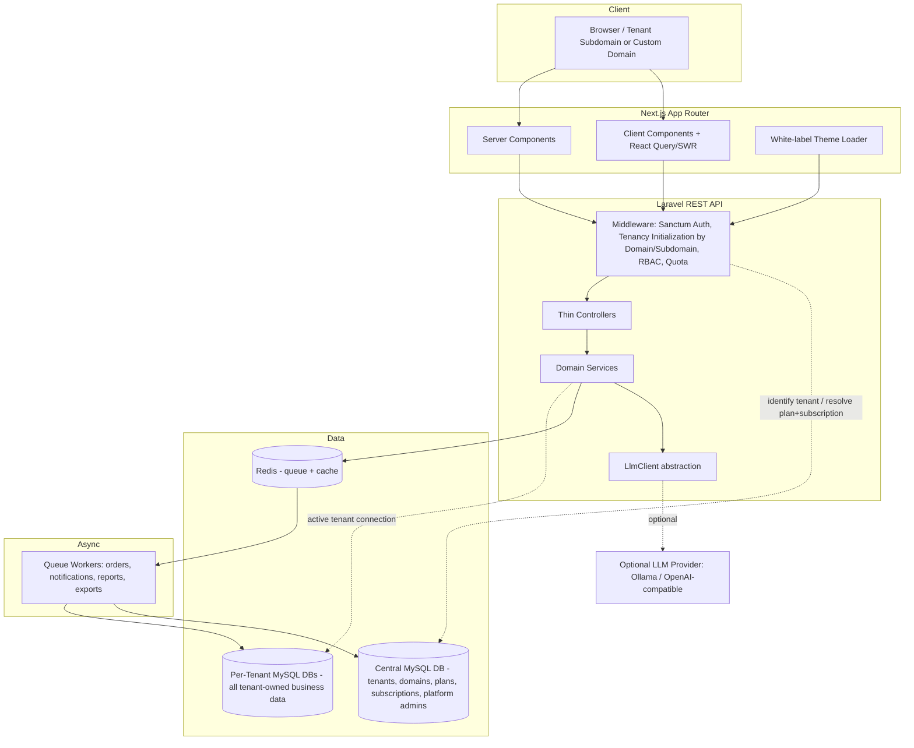
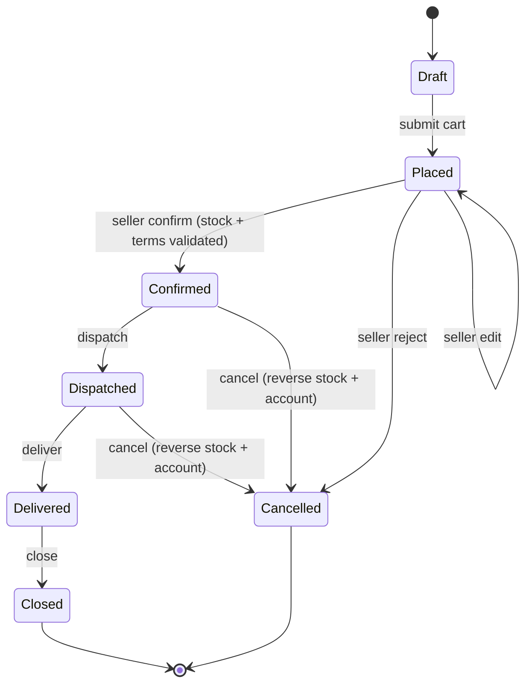
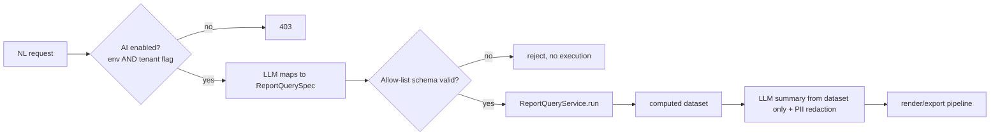

# Design Document

## Overview

This document describes the technical design for a production-grade, multi-tenant, white-label SaaS platform for inventory and distribution management. The platform models a three-tier distribution hierarchy (Company → Distributor → Dealer) and is the single source of truth for all inventory, ordering, payment, and reporting data. It integrates with no external ERP or inventory system — the MySQL database is authoritative.

The design prioritizes correctness under concurrency (stock never oversold), strict tenant isolation enforced through physical database-per-tenant separation, immutable financial/stock ledgers, and resource-light, well-indexed data access. Optional capabilities (AI reporting, WhatsApp/SMS, OTP, exports, advance orders) are gated behind plan feature flags and environment switches so the platform builds and runs with zero optional configuration.

### Technology Stack

| Layer | Technology |
|-------|-----------|
| Frontend | Next.js (App Router), React, TypeScript, Tailwind + shadcn/ui, React Query/SWR, server components where sensible |
| Backend | PHP 8.x, Laravel, clean JSON REST API |
| Multi-tenancy | `stancl/tenancy` (database-per-tenant: central + per-tenant MySQL databases, tenant identification + connection switching) |
| Auth | Laravel Sanctum (token-based) |
| RBAC | spatie/laravel-permission (tenant-scoped roles/permissions, stored per-tenant DB) |
| Audit | owen-it/laravel-auditing |
| Exports | PhpSpreadsheet (Excel/CSV), PDF renderer |
| Database | MySQL 8.x (authoritative store for all data; one central DB + one DB per tenant) |
| Queue/Cache | Redis (async jobs + caching), minimal and optional-friendly |

### Design Principles (Coding Constraints)

These are hard rules reflected throughout the design:

- **Simple, readable code.** Thin controllers delegate to focused services. No god classes, no deep inheritance.
- **Small files and components.** Composable React components; small single-responsibility PHP services.
- **Efficient queries.** Select only needed columns, paginate every list endpoint, eager-load to avoid N+1, cache read-heavy lookups.
- **Stream/queue big work.** Large exports and heavy reports run as queued jobs that stream rows.
- **Reuse connections.** Reuse central and tenant connections; avoid per-request heavy bootstrapping and connection churn. Database-per-tenant has higher connection/resource overhead than a shared-column model — this is accepted as a deliberate tradeoff for strong physical isolation, so tenancy bootstrapping is kept lean (switch the default connection, reuse pooled connections, no redundant re-initialization per request).
- **One query layer for reports and AI.** The AI layer MUST use the exact same report query layer (run against the active tenant database) as standard reports.

## Architecture

### System Context



`stancl/tenancy` resolves the tenant from the subdomain or custom domain and switches Laravel's default database connection to that tenant's database for the remainder of the request (tenancy bootstrappers). The **central** connection serves cross-tenant/platform data (tenants, domains, plans, plan limits, subscriptions, Platform_Admin users). Central (platform-admin) routes and tenant routes are registered as separate route groups.

### Request Pipeline (Middleware Order)

There are two route groups with different pipelines.

**Tenant routes** pass through an ordered middleware stack. Order matters for correctness:

1. **HTTPS enforcement** — reject non-HTTPS (R36.1).
2. **Tenancy initialization** — `stancl/tenancy`'s `InitializeTenancyByDomain` / `InitializeTenancyByDomainOrSubdomain` identifies the tenant from the subdomain/custom domain and switches the default database connection to that tenant's database for the request. A request that resolves to no tenant is rejected.
3. **Sanctum authentication** — resolve the authenticated user (from the now-active tenant database) and token abilities (R7).
4. **RBAC authorization** — authorize the action against the user's abilities (R8.2); Read-only role denies mutations (R8.4).
5. **Subscription + quota guard** — read the plan/limits/subscription from the central database and the live counts from the active tenant database; deny when subscription is `past_due`/`cancelled` and on quota/feature-flag breaches (R5).
6. **Controller → Service** — thin controller validates input and delegates to a domain service that operates on the active tenant connection.

**Central (platform.admin) routes** run WITHOUT tenancy initialization and operate against the central database: HTTPS enforcement → Sanctum authentication → RBAC authorization → controller/service. Because no tenant is initialized, these routes see cross-tenant/platform data by design (R1.6). Impersonation (R8.6) explicitly initializes tenancy for the target tenant's database for the duration of the impersonated session and is audited.

Because isolation is physical (one database per tenant), there is no `tenant_id` discriminator, no global Eloquent scope, and no per-record `tenant_id` comparison guard — the active connection physically cannot address another tenant's data.

### Domain Breakdown

The backend is organized into cohesive domains, each with its own services, models, and routes:

| Domain | Responsibility | Key Requirements |
|--------|----------------|------------------|
| **Tenancy** | Tenant provisioning, isolation, white-label settings | R1, R2, R3 |
| **Subscription/Plans** | Plans, limits, subscriptions, quota + feature-flag enforcement, plan changes | R4, R5, R6 |
| **Auth/RBAC** | Authentication, tokens, roles, abilities, impersonation, sign-up/approval | R7, R8, R9 |
| **Catalog** | Distributors/Dealers, product catalog hierarchy, pricing/discounts, active attributes | R10, R11, R12 |
| **Inventory** | Stock ownership, inward/adjustments, immutable ledger, transfers, reversals, low-stock | R13–R19 |
| **Ordering** | Cart, order lifecycle state machine, confirmation stock movement, advanced order types | R16, R17, R20, R21, R22, R23 |
| **Payments/Accounts** | Manual payments, transaction ledger, outstanding balance, credit/overdue enforcement | R24, R25, R26 |
| **Reporting** | Reusable report query layer, standard reports, exports, scheduling, AI layer | R28, R29, R30, R31, R32 |
| **Notifications** | Email + optional SMS/WhatsApp + in-app notifications | R27 |
| **Admin/Dashboards** | Dashboards, inventory views, delivery challan, audit trail | R33, R34 |
| **Platform (cross-cutting)** | Concurrency/transactions, security, performance, indexing, currency | R35–R39 |

### Service Layer Pattern

Controllers are thin: validate request → call a service method → return a resource. Services encapsulate business rules and own transaction boundaries. Example services:

- `TenantProvisioningService`, `WhiteLabelService`
- `QuotaService` (cached counts/limits), `SubscriptionService`
- `StockMovementService` (the single authority for all stock changes + ledger writes)
- `OrderConfirmationService`, `OrderStateMachine`
- `PaymentService`, `AccountLedgerService`
- `ReportQueryService` (the shared query layer), `ReportExportService`
- `AiReportService` (wraps `ReportQueryService`), `LlmClient`

All stock mutations route through `StockMovementService` so the immutable-ledger and balance-after invariants hold in exactly one place.

## Components and Interfaces

### Multi-Tenant Isolation Strategy

Isolation is **physical**: each tenant owns a separate MySQL database and there is no shared discriminator column. `stancl/tenancy` provides the mechanism.

1. **Central vs tenant connections.** Two logical connections exist. The **central** connection holds platform/cross-tenant data (tenants, domains, plans, plan limits, subscriptions, Platform_Admin users). The **tenant** connection is the default connection *after tenancy is initialized*; it points at the resolved tenant's own database and holds all tenant-owned business data (R1.1).
2. **Tenant identification by domain/subdomain.** On every tenant route, `stancl/tenancy`'s identification middleware resolves the tenant from the request's subdomain or custom domain and the tenancy bootstrappers switch Laravel's default database connection to that tenant's database (R1.2). All subsequent Eloquent/query-builder calls run against that database automatically.
3. **Physical isolation guarantee.** Because queries execute against the tenant's own database connection, a request initialized for tenant A **physically cannot read or write tenant B's data** — there is no cross-tenant row visible on the connection. This replaces the former `tenant_id` global scope and the per-record `tenant_id` comparison guard, both of which are removed (R1.3). There is no `tenant_id` column on tenant-owned tables.

**Platform_Admin exception (R1.6):** Cross-tenant/platform operations run ONLY on central routes tagged `platform.admin` (provisioning, plan management, white-label admin, impersonation setup), which execute against the central database and do not initialize any tenant. On tenant routes a Platform_Admin is subject to the same single-tenant connection as any user. Impersonation (R8.6) initializes tenancy for the **target tenant's database**, issues a short-lived scoped token for that session, and is audited.

**Tenant/user reconciliation guard (R1.6).** A `ReconcileTenantUser` middleware runs in the tenant pipeline immediately AFTER Sanctum authentication and re-affirms that the authenticated token was issued for the tenant whose database is currently active. Each token is stamped with its issuing tenant's id at login (a `tenant_id` column on the per-tenant `personal_access_tokens` table, set from `tenant('id')` while tenancy is initialized); the guard compares that stamp to the active tenant and rejects a mismatch with **403**. A null stamp (legacy / non-login token) is allowed through on the strength of the physical boundary, so the guard never breaks a correctly-scoped request.

*Why the guard is needed when isolation is already physical.* In the normal path a token minted in tenant A's database is simply absent from tenant B's database — the switched connection cannot resolve it, so a cross-tenant replay already fails at Sanctum. The reconciliation guard is **defence in depth** for the edge cases that weaken that guarantee: a tenant database **cloned or restored** from another (carrying the other tenant's token rows), an auto-increment **token-id + secret collision** across two databases, or a future refactor that authenticates against a shared token store. In each case the stamp still binds the token to exactly one tenant and the guard rejects the mismatch. The guard makes the R1.6 invariant explicit and testable rather than relying on the physical boundary alone.

```
Tenancy context (managed by stancl/tenancy)
  - central routes:   no tenant initialized; default connection = central
  - tenant routes:    tenant resolved from domain/subdomain;
                      default connection switched to that tenant's database
  - impersonation:    Platform_Admin initializes tenancy for the target tenant DB
```

Unique constraint on `Tenant(subdomain)` lives in the **central** database (R1.4). "Exactly one Company per Tenant" (R1.5) is now naturally enforced because each tenant database contains a single `companies` row — a singleton/uniqueness check within the tenant database replaces the former `unique(tenant_id)` constraint.

> **Resource tradeoff:** database-per-tenant has higher connection and resource overhead than a shared-column model. This is accepted deliberately in exchange for strong physical isolation. Connection usage is kept lean (reuse central/tenant connections, avoid heavy per-request bootstrapping).

### Tenant Provisioning

`TenantProvisioningService` creates a tenant end-to-end using `stancl/tenancy`'s tenant-creation lifecycle, run as a queued job so the slow database work does not block the request:

1. In the **central** database, create the `Tenant` record (with its generated database name), its `Domain` row (subdomain/custom domain), and the `Subscription` record (plan + status). A duplicate subdomain/domain is rejected with **409** before any database is created (R2.3).
2. **Create and migrate the new tenant database.** `stancl/tenancy` creates a dedicated MySQL database for the tenant and runs the tenant migration set against the tenant connection, building the full tenant schema (companies, catalog, stock, orders, payments, ledgers, users, roles/permissions, audit, settings).
3. Within the new tenant database, seed the tenant's single `Company`, the initial `Company_Admin` user, default roles/permissions, and starter `tenant_settings`/defaults (R2.1, R4.7).

The central database remains the source of truth for the tenant/domain/subscription records; the tenant database is the source of truth for that tenant's company, admin, and all business data. Provisioning is idempotent and audited on the central side.

### White-Labeling

Per-tenant settings (logo, brand name, colour theme, favicon, outbound email sender identity) are stored in a `tenant_settings` row inside the tenant's own database (R3.1); the subdomain/custom-domain mapping lives in the central `domains` table used for resolution. The frontend theme loader fetches branding for the resolved domain and applies logo/theme/favicon on page load (R3.2). Outbound mail uses a per-tenant mailer configuration for the sender identity (R3.3). White-label updates are applied even if the audit write fails — the audit write is best-effort and non-blocking (R3.5).

**Custom-domain + subdomain resolution (R3.4).** Both a subdomain host (`<subdomain>.<central_domain>`) and a verbatim custom domain (`shop.acme-brand.test`) are resolved to a tenant through the **same** central `domains` table that `stancl/tenancy`'s identification middleware consults. `InitializeTenancyByDomainOrSubdomain` already covers both cases: it matches the request host against a `domains.domain` row (custom domains stored verbatim) and, failing that, resolves the leftmost label as a subdomain of a configured central domain. Provisioning (and white-label custom-domain updates) write the resolution row into the central `domains` table, so no separate resolver layer is needed — the identification middleware + `domains` table is the single resolution path. An unresolved host is rejected with 403 by the shared `onFail` handler (R1.4).

### Auth & RBAC

- **Sanctum tokens** issued on valid login (R7.1); passwords hashed with bcrypt/argon2 (R7.3). Invalid credentials → 401 + audited failed attempt (R7.2).
- **Password reset** emails a reset link (R7.4).
- **OTP login** offered only where the `otp_login` flag is enabled (R7.5).
- **Roles** (spatie): Platform_Admin, Company_Admin, Company_Staff, Distributor, Dealer, Read-only (R8.1). Every action authorizes against abilities (R8.2) → 403 on denial (R8.3). Read-only permits dashboards/reports, denies all mutations (R8.4).
- **`GET /api/me`** returns identity, roles, abilities (R8.5).
- **Impersonation** by Platform_Admin issues a short-lived scoped token and audits the session (R8.6).
- **Sign-up/approval:** prospects recorded as `pending` (R9.1); approval creates Distributor/Dealer + audit + account-created email (R9.2, R9.4); rejection marks `rejected` + audit (R9.3).

Security-relevant events (login, logout, password reset, OTP verify) are audited (R7.6).

### Catalog Domain

- **Distributors/Dealers:** created with contact, GSTIN, address, Payment_Terms; a Distributor belongs to exactly one Company, a Dealer to exactly one Distributor (R10.1–R10.3). `max_dealers_per_distributor` enforced at creation (R10.4). Payment_Terms updates are stored and audited (R10.5).
- **Catalog hierarchy:** Category → Collection → Colour; Products carry SKU, tax type, unit of measure (R11.2). Unique `Product(sku)` within the tenant database (R11.1) — SKU uniqueness is per-tenant automatically because each tenant has its own `products` table.
- **Active product attributes:** per-Buyer visibility restriction. Where configured, the Buyer sees only the configured Categories/Collections/Colours (R11.4, R11.5); where unconfigured, all products are visible (R11.6).
- **Pricing:** Prices at Product and Collection levels (R12.1); markup/MUP per Collection (R12.2); discount types `customer` and `online` only (R12.3). Order-line price resolves applicable price + cumulative discounts in the tenant's single currency (R12.4, R12.5).

### Inventory Engine

The inventory engine is the correctness-critical heart of the system. All stock changes flow through `StockMovementService`, which guarantees atomicity, immutable ledger writes, and the balance-after invariant.

**Stock ownership (polymorphic).** `StockPoint` is owned polymorphically by a Company or Distributor (and optionally Dealer when enabled). `Stock` is a per-(owner, product, stock_point) quantity (R13.3–R13.8). Dealers hold no stock unless dealer stock-holding is enabled for the tenant (R13.6, R13.7).

**Atomic stock movement with row locking.** Any operation that changes stock:

1. Opens a single DB transaction.
2. Reads every affected `stock` row with `SELECT ... FOR UPDATE` in a deterministic order (sorted by primary key) to acquire row locks and avoid deadlocks (R16.5, R35.1).
3. Validates the resulting quantities (negative-stock check unless backorders enabled).
4. Applies all increments/decrements.
5. Writes an immutable `stock_ledger` entry per movement, setting `balance_after` equal to the post-movement stock quantity (R15.1, R15.3).
6. Commits — or rolls back entirely on any failure (R14.2, R35.2, R35.3).

```
StockMovementService.apply(movements: Movement[], context)
  // Movement = { ownerType, ownerId, productId, stockPointId, delta, type, reason, reference }
  DB::transaction:
    rows = lockStockRowsForUpdate(movements)       // SELECT ... FOR UPDATE, ordered
    foreach m in movements:
      newQty = rows[m.key].quantity + m.delta
      if newQty < 0 and not tenant.backorders_enabled:
        throw InsufficientStockError(collect all offenders)   // all-or-nothing
    foreach m in movements:
      rows[m.key].quantity = rows[m.key].quantity + m.delta
      save(row)
      StockLedger.create({..., quantity: m.delta, balance_after: row.quantity})
```

**Negative-stock prevention (all-or-nothing).** If any line would drive stock below zero and backorders are disabled, the entire operation is rejected and no stock changes are applied (R17.1); the response is 422 listing the insufficient products (R17.3). With backorders enabled, confirmation proceeds and the backordered quantity is recorded (R17.2).

**Immutable ledger.** `stock_ledger` rows cannot be updated or deleted — enforced in the model (no update/delete) and, defensively, by withholding UPDATE/DELETE privileges where feasible (R15.2).

**Backorder toggle** is a per-tenant setting consulted during the negative-stock check (R17.2).

**Stock transfer** between two stock points of the same owner decrements source, increments destination, writes two ledger entries, all in one transaction (R18.1).

**Cancellation / return reversal.** Cancellation writes reversing ledger entries restoring the confirmation's quantities (R18.2, R22.1). Returns re-enter returned quantities and write ledger entries (R18.3, R22.2), then adjust the buyer account (R22.2, R22.3).

**Low-stock alerts.** A per-(product, stock_point) threshold (R19.1); when stock falls to/below threshold a low-stock alert is raised (R19.2); a low-stock report/export lists all breaching products (R19.3, R28.8).

**Stock blocking/reservation.** In-progress and advance orders reserve stock via a `stock_reservation` record that reduces available quantity without moving owned quantity (R23.4). Available = on-hand − active reservations. Cancellation/expiry releases reservations back to available (R23.5).

### Ordering Domain & Order State Machine

**Cart.** A cart accumulates multiple lines; submitting the cart creates one Order with an Order_Line per entry (R20.3, R20.4). Distributor orders are placed against the Company catalogue (R20.1); Dealer orders against the serving Distributor's stock (R20.2).

**State machine.** States: Draft → Placed → Confirmed → Dispatched → Delivered → Closed, with Cancelled reachable from pre-terminal states (R21.1). Illegal transitions return 422 (R21.4).



Transition rules are declared in a single `OrderStateMachine` map `{ fromState: { event: toState } }`; the service rejects any event not present for the current state (R21.4). While Placed, the seller may approve/reject/edit before confirmation (R21.2).

**Confirmation (synchronous, transactional).** On confirm (R21.3, R21.5, R16.4):

```
OrderConfirmationService.confirm(order):
  DB::transaction:
    assertTransition(order, 'confirm')                 // 422 if illegal
    movements = buildMovements(order)                  // seller decrement (+ buyer increment)
    StockMovementService.apply(movements)              // FOR UPDATE locks, all-or-nothing
    assertCreditWithinLimit(order.buyer, order.total)  // 422/blocked if over credit limit
    invoice = InvoiceService.generate(order, seller.invoiceSeries) // per-seller series
    AccountLedgerService.appendPurchase(order.buyer, order.total)  // transaction ledger
    order.status = Confirmed
  // after commit: queue order-confirmed notification
```

The invoice uses the seller's own invoice series and is generated synchronously inside the confirmation transaction before the response returns (R21.5). Credit-limit and overdue checks are evaluated at confirmation time (R26.2).

**Advanced order types.**
- **Blanket orders** define scheduled releases (R23.1); each release triggers a confirmation-style movement when due.
- **Advance orders** are gated by the `advance_orders` flag and reserve future/blocked stock (R23.2).
- **Depot orders/invoices** are recorded at the stock-point level (R23.3).

### Payments & Accounts

- **Manual payment recording** persists amount, method, reference, date, recorded-by (R24.1), writes a Transaction_Ledger entry, and updates the running balance (R24.2). Partial payments and allocation to one or more invoices are supported (R24.3). A payment-recorded email is sent (R24.4, R27.4).
- **Transaction ledger (immutable).** Every confirmed purchase or payment appends a `transaction_ledger` row with amount and `balance_after` (R25.1). Entries are immutable (R25.3). Outstanding_Balance is the latest `balance_after` (R25.2).
- **Credit & overdue enforcement.** Per-Buyer Payment_Terms hold credit limit, overdue balance limit, overdue hold days, payment type (R26.1). Confirmation is blocked if projected outstanding exceeds the credit limit — only at confirmation time (R26.2). Invoices unpaid beyond overdue hold days are flagged overdue (R26.3). If overdue balance exceeds its limit, the buyer is blocked from new orders (R26.4). Authorized overrides with a reason permit the blocked action and are audited (R26.5).

### Reporting Engine

A single reusable, role-aware `ReportQueryService` is the one query path for both standard reports and the AI layer (R29, R31.3). It always runs against the **active tenant database** (the connection switched in by tenancy initialization), so tenant scoping is physical rather than a query predicate.

```
ReportQuerySpec {
  type: enum(stock_on_hand, stock_ledger, sales, purchases, outstanding_ageing,
            payments, order_status, low_stock, plan_usage)
  filters: { dateRange?, buyerId?, sellerId?, productId?, categoryId?, stockPointId?, status? }
  grouping: string[]      // allow-listed columns only
  sort: { column, dir }[] // allow-listed columns only
  limit: int
  page: int
}

ReportQueryService.run(spec, user):
  spec = applyDefaults(spec)          // dateRange defaults to previous calendar month (R29.2)
  authorizeRole(spec, user)           // role scoping; tenant scoping is physical (active tenant DB) (R28.10)
  cacheKey = hash(currentTenant, spec)  // key namespaced per tenant for cache isolation
  return cache.remember(cacheKey, shortTtl, () => executeIndexedAggregation(spec))  // runs on active tenant connection
```

- Filters: date range, buyer/seller, product/category, stock point, status (R29.1); missing date range defaults to previous calendar month (R29.2).
- Pagination + SQL-side aggregation + indexed queries (R29.3).
- Standard report catalog: stock-on-hand, stock-ledger, sales (by period/distributor/dealer/product/category), purchases, outstanding-ageing (buckets current/1-30/31-60/61-90/90+), payments/collections, order-status/delivery-challan, low-stock, plan-usage (R28.1–R28.9).
- Results restricted to the active tenant database (physical) and further to role-permitted data (R28.10).
- Exports (where `exports` flag enabled) to Excel/CSV/printable PDF (R29.4); large exports run as queued streaming jobs with a download link on completion (R29.5).
- Scheduled/subscription reports default to previous calendar month and email recipients (R29.6).
- Missing/soft-deleted relations are silently omitted without error (R29.7).
- Expensive aggregates cached per (tenant, report, filter) with short TTL and invalidated on relevant writes (R29.8).

### AI Reporting Layer

The AI layer is a thin wrapper over `ReportQueryService`, gated behind both the `AI_REPORTS_ENABLED` env master switch and the tenant `ai_reports` flag (R30.6, R30.7).

```
interface LlmClient { complete(prompt: string): string }
  resolved from config (R30.4):
    LLM_PROVIDER=ollama            -> OllamaClient
    LLM_PROVIDER=openai_compatible -> HttpLlmClient
    LLM_PROVIDER=none | AI disabled -> NullLlmClient (graceful no-op)  (R30.5)
```

Env keys (R30.2): `AI_REPORTS_ENABLED` (default false — R30.1), `LLM_PROVIDER` (ollama|openai_compatible|none), `LLM_MODEL`, `LLM_BASE_URL`, `LLM_API_KEY`, `LLM_TIMEOUT`. The app builds and runs with zero AI config (R30.3).

**NL → validated query spec (never raw SQL).** A natural-language request is mapped by the LLM to a structured `ReportQuerySpec` (R31.1), validated against an allow-listed schema (types, groupable/sortable columns) before execution (R31.2). The validated spec runs through the same `ReportQueryService` (R31.3). Raw SQL from the model is never executed (R31.4); schema-validation failure rejects the request without executing anything (R31.5). Results return through the standard render/export pipeline (R31.6).

**Summaries & follow-ups** are computed from the returned dataset only (R32.1, R32.2). Guardrails: minimum aggregated data sent, PII redacted before transmission (R32.3), tenant+role scoped (R32.4), every AI request audited (R32.5).



### Notifications

- Email notifications: account-created (R27.1), order-placed (R27.2), order-confirmed (R27.3), payment-recorded (R27.4). All delivered via queued jobs.
- Optional SMS/WhatsApp channels where `whatsapp_notifications` is enabled (R27.5).
- In-app notifications with history, mark-one-read and mark-all-read (R27.6).

### Dashboards, Inventory Views, Audit

- Company master dashboard of key metrics (R33.1); stock-on-hand, item-detail, and pending-orders views listing Orders placed but not yet confirmed or fulfilled (R33.2); dashboard/inventory export for Company_Admin where `exports` enabled, without further authorization (R33.3); delivery-challan printing (R33.4, R28.7).
- Audit trail (owen-it/laravel-auditing): create/update/delete of tenant-owned records recorded with actor, timestamp, record identity in the tenant database's `audit_logs` table (R34.1); entries append-only (R34.2); limit overrides, impersonation, plan changes, stock adjustments recorded with reason (R34.3). Platform-level actions (provisioning, plan changes, impersonation setup) are audited on the central side.

### API Surface Overview

Clean JSON REST, grouped per domain. Tenant endpoints resolve to the active tenant database via tenancy initialization; central (`platform.admin`) endpoints run against the central database without tenancy. Every list endpoint is paginated.

| Domain | Representative Endpoints |
|--------|--------------------------|
| Auth | `POST /auth/login`, `POST /auth/logout`, `POST /auth/password/reset`, `POST /auth/otp`, `GET /me` |
| Tenancy (platform.admin) | `POST /admin/tenants`, `PATCH /admin/tenants/{id}`, `POST /admin/impersonate/{userId}` |
| White-label | `GET /tenant/settings`, `PATCH /tenant/settings` |
| Plans/Subscription | `GET /admin/plans`, `POST /admin/plans`, `PATCH /admin/subscriptions/{id}`, `GET /usage` |
| Sign-up/Approval | `POST /signup`, `POST /prospects/{id}/approve`, `POST /prospects/{id}/reject` |
| Catalog | `GET/POST /distributors`, `GET/POST /dealers`, `GET/POST /products`, `GET /catalog`, `GET/POST /prices` |
| Inventory | `GET /stock`, `POST /stock/inward`, `POST /stock/adjust`, `POST /stock/transfer`, `GET /stock/low` |
| Ordering | `POST /cart`, `POST /orders`, `POST /orders/{id}/confirm`, `POST /orders/{id}/cancel`, `POST /orders/{id}/return`, `POST /orders/{id}/transition` |
| Payments | `POST /payments`, `GET /buyers/{id}/ledger`, `GET /buyers/{id}/outstanding` |
| Reporting | `GET /reports/{type}`, `POST /reports/export`, `POST /reports/schedule` |
| AI Reporting | `POST /ai/reports`, `POST /ai/reports/{id}/summary`, `POST /ai/reports/{id}/followup` |
| Notifications | `GET /notifications`, `POST /notifications/{id}/read`, `POST /notifications/read-all` |
| Dashboards | `GET /dashboard`, `GET /inventory/views/{view}`, `GET /orders/{id}/challan` |

## Data Models

MySQL 8.x is the authoritative store (R13.1, R13.2), organized as one **central** database plus one **tenant** database per tenant. Tenant-owned tables carry **no** `tenant_id` column — isolation is physical at the database level. Monetary values use `DECIMAL(15,2)`; quantities use `DECIMAL(15,3)` to support fractional units of measure. Soft deletes (`deleted_at`) are used on master-data tables so reports can defensively omit missing relations (R29.7); ledgers are never soft-deleted (append-only).

**Database placement:**

- **Central database:** `Tenant`, `Domain`, `Plan`, `Plan_Limit`, `Subscription`, and Platform_Admin `User` records.
- **Each tenant database:** `Company`, `Distributor`, `Dealer`, `Category`, `Collection`, `Colour`, `Product`, `Price`, `Stock_Point`, `Stock`, `Stock_Ledger`, `Stock_Reservation`, `Order`, `Order_Line`, `Invoice`, `Payment`, `Payment_Allocation`, `Transaction_Ledger`, `Overdue_Amount`, tenant `User`s, tenant-scoped roles/permissions, `Audit_Log`, `Notification`, `Tenant_Settings`.

### Entity-Relationship Diagram

The diagram below groups entities by the database they live in. Relationships between the central and tenant databases (e.g. a Subscription referencing a Tenant) are logical references across databases, not SQL foreign keys.

```mermaid
erDiagram
    %% ===== CENTRAL DATABASE =====
    TENANT ||--o{ DOMAIN : "resolved by"
    TENANT ||--o{ SUBSCRIPTION : "subscribes (logical ref)"
    PLAN ||--o{ PLAN_LIMIT : "defines"
    PLAN ||--o{ SUBSCRIPTION : "assigned to"

    %% ===== TENANT DATABASE (one per tenant) =====
    COMPANY ||--o{ DISTRIBUTOR : "sells to"
    DISTRIBUTOR ||--o{ DEALER : "sells to"
    CATEGORY ||--o{ COLLECTION : contains
    COLLECTION ||--o{ COLOUR : contains
    COLLECTION ||--o{ PRODUCT : groups
    PRODUCT ||--o{ PRICE : "priced by"
    COLLECTION ||--o{ PRICE : "priced by"
    STOCK_POINT ||--o{ STOCK : holds
    PRODUCT ||--o{ STOCK : "stocked as"
    STOCK ||--o{ STOCK_LEDGER : "movements"
    STOCK_POINT ||--o{ STOCK_RESERVATION : reserves
    ORDER ||--o{ ORDER_LINE : "has lines"
    PRODUCT ||--o{ ORDER_LINE : "ordered as"
    ORDER ||--o| INVOICE : "generates"
    PAYMENT ||--o{ PAYMENT_ALLOCATION : "allocates to"
    INVOICE ||--o{ PAYMENT_ALLOCATION : "paid by"
    PLATFORM_USER }o--o{ ROLE : "assigned"
    TENANT_USER }o--o{ ROLE : "assigned"
    ROLE }o--o{ PERMISSION : "grants"

    %% ---------- CENTRAL ----------
    TENANT {
        bigint id PK
        string subdomain UK "central"
        string database_name "tenant DB name"
        string currency
        bool backorders_enabled
        bool dealer_stock_enabled
    }
    DOMAIN {
        bigint id PK
        bigint tenant_id FK "central"
        string domain UK "subdomain or custom domain"
    }
    PLAN {
        bigint id PK
        string name
        decimal price
        enum billing_cycle "monthly|yearly"
        bool is_active
    }
    PLAN_LIMIT {
        bigint id PK
        bigint plan_id FK
        string key
        bigint value "0/NULL = unlimited"
    }
    SUBSCRIPTION {
        bigint id PK
        bigint tenant_id "logical ref to central Tenant"
        bigint plan_id FK
        enum status "active|past_due|cancelled|trial"
        datetime starts_at
        datetime ends_at
        datetime trial_ends_at
    }
    PLATFORM_USER {
        bigint id PK "central Platform_Admin"
        string email UK
        string password_hash
    }

    %% ---------- TENANT DB (no tenant_id anywhere) ----------
    COMPANY {
        bigint id PK "singleton per tenant DB"
        string name
        string gstin
    }
    DISTRIBUTOR {
        bigint id PK
        bigint company_id FK
        string gstin
        json payment_terms
    }
    DEALER {
        bigint id PK
        bigint distributor_id FK
        string gstin
        json payment_terms
    }
    CATEGORY {
        bigint id PK
        string name
    }
    COLLECTION {
        bigint id PK
        bigint category_id FK
        string name
    }
    COLOUR {
        bigint id PK
        bigint collection_id FK
        string name
    }
    PRODUCT {
        bigint id PK
        string sku UK "unique within tenant DB"
        bigint collection_id FK
        bigint colour_id FK
        string tax_type
        string uom
    }
    PRICE {
        bigint id PK
        string level "product|collection"
        bigint ref_id
        decimal amount
        string markup_type "markup|mup"
    }
    STOCK_POINT {
        bigint id PK
        string owner_type "polymorphic"
        bigint owner_id
        int sort_order
        string name
    }
    STOCK {
        bigint id PK
        string stockable_type "owner polymorphic"
        bigint stockable_id
        bigint product_id FK
        bigint stock_point_id FK
        decimal quantity
        decimal low_stock_threshold
    }
    STOCK_LEDGER {
        bigint id PK
        string stockable_type
        bigint stockable_id
        bigint product_id FK
        bigint stock_point_id FK
        string movement_type
        decimal quantity "signed delta"
        decimal balance_after
        string reason
        bigint actor_id
        string reference
        datetime created_at
    }
    STOCK_RESERVATION {
        bigint id PK
        bigint stock_id FK
        bigint order_id FK
        decimal quantity
        string status "active|released"
    }
    ORDER {
        bigint id PK
        string buyer_type
        bigint buyer_id
        string seller_type
        bigint seller_id
        enum status
        string order_type "standard|blanket|advance|depot"
        decimal total
        datetime created_at
    }
    ORDER_LINE {
        bigint id PK
        bigint order_id FK
        bigint product_id FK
        decimal quantity
        decimal unit_price
        decimal discount
    }
    INVOICE {
        bigint id PK
        bigint order_id FK
        string series
        string number
        decimal amount
        bool overdue
    }
    PAYMENT {
        bigint id PK
        string buyer_type
        bigint buyer_id
        decimal amount
        string method
        string reference
        date paid_on
        bigint recorded_by
        datetime created_at
    }
    PAYMENT_ALLOCATION {
        bigint id PK
        bigint payment_id FK
        bigint invoice_id FK
        decimal amount
    }
    TRANSACTION_LEDGER {
        bigint id PK
        string buyer_type
        bigint buyer_id
        string entry_type "purchase|payment|return"
        decimal amount "signed"
        decimal balance_after
        bigint reference_id
        datetime created_at
    }
    OVERDUE_AMOUNT {
        bigint id PK
        string buyer_type
        bigint buyer_id
        decimal amount
        int days_overdue
    }
    TENANT_USER {
        bigint id PK "tenant DB user"
        string email
        string password_hash
    }
    AUDIT_LOG {
        bigint id PK
        bigint actor_id
        string action
        string auditable_type
        bigint auditable_id
        json old_values
        json new_values
        string reason
        datetime created_at
    }
```



### Documented Indexes

Each index below exists to serve a specific hot query path. Because tenant tables live in physically separate databases, they no longer carry a `tenant_id` column: the former "composite `(tenant_id, filter)`" guidance is replaced by plain filter-column indexes within each tenant database. The central-database indexes (tenant/domain resolution, plans, subscriptions) remain as the authoritative cross-tenant lookups (R38.1–R38.4).

**Central database indexes**

| Table | Index | Rationale |
|-------|-------|-----------|
| `tenants` | UNIQUE(`subdomain`) | Enforce unique subdomain and fast resolution (R1.4). Lives in the central database. |
| `domains` | UNIQUE(`domain`) | Resolve a subdomain/custom domain → tenant for tenancy initialization (R1.4, R3.4). |
| `plan_limits` | (`plan_id`, `key`) | Resolve a specific quota for a plan (R5.1). |
| `subscriptions` | (`tenant_id`, `status`) | Resolve a tenant's active subscription + status gate (R5.7). `tenant_id` here is a central reference to the Tenant, not a discriminator. |

**Tenant database indexes** (one set per tenant database; no `tenant_id` column)

| Table | Index | Rationale |
|-------|-------|-----------|
| `companies` | (no `tenant_id`; singleton row) | Exactly one Company per tenant is enforced by a singleton/uniqueness check within the tenant DB (R1.5). |
| `products` | UNIQUE(`sku`) | Enforce SKU uniqueness within the tenant; fast SKU lookup (R11.1). |
| `products` | (`collection_id`) | Catalog browse filtered by collection. |
| `distributors` | (`company_id`) | List distributors under the company. |
| `dealers` | (`distributor_id`) | List/enforce dealers per distributor (R10.4). |
| `stock` | (`stockable_type`, `stockable_id`, `product_id`, `stock_point_id`) | The core stock lookup/locking key for movement and stock-on-hand (R16, R28.1). Never had `tenant_id`. |
| `stock` | (`stock_point_id`) | Stock-on-hand report per stock point (R28.1). |
| `stock_ledger` | (`stockable_type`, `stockable_id`, `product_id`, `created_at`) | Ledger movement report ordered by time per owner/product (R28.2). Never had `tenant_id`. |
| `stock_ledger` | (`created_at`) | Date-range ledger scans within the tenant. |
| `stock_reservations` | (`stock_id`, `status`) | Compute available = on-hand − active reservations (R23.4). |
| `orders` | (`buyer_type`, `buyer_id`, `status`, `created_at`) | Order listings/filters by buyer and status over time; monthly order quota (R5.3, R28.7). |
| `orders` | (`seller_type`, `seller_id`, `status`) | Seller approval queue of Placed orders (R21.2). |
| `order_lines` | (`order_id`) | Eager-load lines for an order without N+1 (R38.1). |
| `invoices` | (`series`, `number`) | Per-seller invoice series uniqueness and lookup (R21.5). |
| `transaction_ledger` | (`buyer_type`, `buyer_id`, `created_at`) | Latest balance_after + account history per buyer (R25.2). |
| `payments` | (`buyer_type`, `buyer_id`, `created_at`) | Payment/collection reports by buyer over time (R28.6). |
| `payment_allocations` | (`invoice_id`) | Resolve amounts allocated per invoice (R24.3). |
| `overdue_amounts` | (`buyer_type`, `buyer_id`) | Overdue enforcement lookup (R26.4). |
| `audit_logs` | (`auditable_type`, `auditable_id`, `created_at`) | Audit history per record (R34.1). |

All foreign-key columns are indexed, and all columns used in WHERE/JOIN/ORDER BY are covered by the indexes above (R38.2, R38.3).

### Quota Caching Model

`QuotaService` caches, per tenant, the current count and active limit for each counted resource. Counts are computed by querying the **active tenant database** (counts of Distributors, Dealers, Products, Stock_Points, Users within that tenant DB), while the plan, its limits, and the subscription status are read from the **central database**. The cache is invalidated when a counted resource is created or deleted (R5.6). A limit of `0` or `NULL` means unlimited (R4.4). Enforcement compares count vs limit before creation and returns 403 naming the exceeded quota on breach (R5.1, R5.2).

## Correctness Properties

*A property is a characteristic or behavior that should hold true across all valid executions of a system — essentially, a formal statement about what the system should do. Properties serve as the bridge between human-readable specifications and machine-verifiable correctness guarantees.*

This feature is well suited to property-based testing because the correctness-critical core (stock movement arithmetic, ledger balance invariants, the order state machine, quota comparison, discount calculation, ageing buckets, tenant isolation, and AI guardrails) is pure, input-varying logic where 100+ generated inputs reveal edge cases far better than a handful of examples. Infrastructure, UI rendering, and configuration criteria are handled by unit/integration/smoke tests described in the Testing Strategy, not here.

The following properties are the consolidated result of the acceptance-criteria prework and property reflection.

### Property 1: Tenant isolation invariant (physical database separation)

*For any* two tenants A and B, each with its own database, and *any* authenticated non-platform-admin request initialized for tenant A's database, every query and record access resolves exclusively within tenant A's database and cannot read or write any record in tenant B's database — isolation is physical at the connection level, not a predicate. Reporting likewise returns only data from the active tenant's database. A Platform_Admin obtains cross-tenant access only on central/provisioning routes (which run without tenancy initialization) or through audited impersonation that initializes the target tenant's database; on ordinary tenant routes it is confined to the single active tenant database like any other user.

**Validates: Requirements 1.2, 1.3, 1.6, 28.10, 32.4**

### Property 2: Stock movement correctness and conservation

*For any* confirmed order (distributor or dealer), applying the movement decrements the seller's stock and, where the buyer holds stock, increments the buyer's stock by exactly each line quantity; when dealer stock-holding is disabled no dealer stock is created or incremented; for transfers between two stock points of one owner the total owned quantity is conserved.

**Validates: Requirements 13.6, 14.1, 16.1, 16.2, 16.3, 18.1, 18.3, 22.2**

### Property 3: Ledger balance-after invariant

*For any* sequence of stock movements applied to an owner/product/stock_point, each resulting `stock_ledger` entry records the signed movement quantity and a `balance_after` exactly equal to the owner's stock quantity after that movement, and carries movement type, reason, actor, timestamp, and reference.

**Validates: Requirements 14.5, 15.1, 15.3**

### Property 4: Negative-stock prevention is all-or-nothing (single operation)

*For any* order confirmation where at least one line would drive stock below zero and backorders are disabled, the entire confirmation is rejected and no stock quantity or ledger entry changes persist; where backorders are enabled the confirmation succeeds and the recorded backordered quantity equals the shortfall.

**Validates: Requirements 17.1, 17.2**

### Property 5: No overselling under concurrency

*For any* number of order confirmations executed concurrently against the same shared stock with backorders disabled, serialized row-level locking ensures no stock quantity ever becomes negative and the total quantity across all successful confirmations never exceeds the initial available quantity.

**Validates: Requirements 16.5, 35.1**

### Property 6: Atomic all-or-nothing writes

*For any* inventory or payment operation that fails at any point before completion, the system rolls back entirely so that no stock, ledger, invoice, or account change from that operation persists.

**Validates: Requirements 14.2, 16.4, 35.2, 35.3**

### Property 7: Confirmation/cancellation round-trip restores stock

*For any* confirmed order, cancelling it writes reversing ledger entries that restore every affected stock quantity to its exact pre-confirmation value.

**Validates: Requirements 18.2, 22.1**

### Property 8: Transaction-ledger balance consistency

*For any* sequence of account-affecting events (confirmed purchases, payments, returns) for a buyer, each `transaction_ledger` entry's `balance_after` equals the previous `balance_after` plus the signed amount, and the buyer's Outstanding_Balance equals the latest `balance_after`.

**Validates: Requirements 22.3, 24.2, 25.1, 25.2**

### Property 9: Append-only ledgers reject mutation

*For any* existing `stock_ledger`, `transaction_ledger`, or `audit_log` entry, every attempt to update or delete it is rejected and the entry remains unchanged.

**Validates: Requirements 15.2, 25.3, 34.2**

### Property 10: Order state-machine transition legality

*For any* order state and transition event, the transition is accepted if and only if it is defined in the transition map for that state; undefined transitions are rejected with 422 and leave the order unchanged.

**Validates: Requirements 21.2, 21.4**

### Property 11: Invoice generation on confirmation

*For any* confirmed order, exactly one invoice is generated within the confirmation transaction using the seller's own invoice series, and invoice numbers are strictly increasing within each seller series.

**Validates: Requirements 21.5**

### Property 12: Cart-to-order fidelity

*For any* cart of N line entries, submitting it creates exactly one order containing N order lines whose products and quantities match the cart entries.

**Validates: Requirements 20.3, 20.4**

### Property 13: Stock reservation availability and round-trip

*For any* set of active reservations against a stock row, available quantity equals on-hand minus the sum of active reservations and the reserved quantity is unavailable to other orders; reserving then cancelling/expiring restores available quantity to its prior value.

**Validates: Requirements 23.4, 23.5**

### Property 14: Low-stock alerting and reporting

*For any* stock quantity and configured threshold, a low-stock alert is raised and the product appears in the low-stock report if and only if the quantity is at or below the threshold.

**Validates: Requirements 19.2, 19.3**

### Property 15: Quota comparison enforcement

*For any* current resource count and active plan limit, creation is permitted if and only if the limit is unlimited (0 or NULL) or the count is strictly less than the limit; otherwise creation is rejected with 403 naming the exceeded quota. This holds for distributors, dealers (including per-distributor limits), products, stock points, users, and monthly orders.

**Validates: Requirements 4.4, 5.1, 5.2, 5.3, 10.4**

### Property 16: Quota cache consistency

*For any* sequence of create and delete operations on a counted resource, the cached per-tenant count after cache invalidation always equals the actual database count.

**Validates: Requirements 5.6**

### Property 17: Subscription-status gating

*For any* subscription status, creation of new tenant-owned resources is denied with 403 if and only if the status is `past_due` or `cancelled`.

**Validates: Requirements 5.7**

### Property 18: Downgrade usage protection

*For any* current usage and target plan limit, a plan downgrade is blocked (with a message naming the violating resource) if and only if the target limit is below current usage and the change is not explicitly forced.

**Validates: Requirements 6.2, 6.3**

### Property 19: Feature-flag gating

*For any* optional module gated by a feature flag, access is permitted if and only if the flag is enabled; AI reporting is permitted if and only if both the `AI_REPORTS_ENABLED` master switch and the tenant `ai_reports` flag are enabled, otherwise the request is denied with 403.

**Validates: Requirements 5.4, 7.5, 23.2, 27.5, 30.6, 30.7**

### Property 20: RBAC authorization

*For any* (role, action) pair, the action executes if and only if the role holds the required ability; otherwise it is rejected with 403. The Read-only role is permitted view actions and denied all mutations.

**Validates: Requirements 8.2, 8.3, 8.4, 36.3**

### Property 21: Password hashing

*For any* password, the stored credential is a bcrypt or argon2 hash that is never equal to the plaintext and that verifies successfully against the original password.

**Validates: Requirements 7.3**

### Property 22: Catalog visibility restriction

*For any* buyer and configured active-attribute set, the catalog returned contains only products within the allowed Categories/Collections/Colours; when no restriction is configured, the catalog contains all of the tenant's products.

**Validates: Requirements 11.4, 11.5, 11.6**

### Property 23: Pricing and discount calculation

*For any* order line with an applicable price and set of applicable discounts (`customer` and/or `online`), the computed price equals the base price with all applicable discounts applied cumulatively, is never negative, and is expressed in the tenant's single configured currency.

**Validates: Requirements 12.4, 12.5, 39.1**

### Property 24: Credit-limit enforcement at confirmation

*For any* buyer with current outstanding balance O, order total T, and credit limit L, confirmation is blocked if and only if O + T exceeds L, and this check is applied only at confirmation time.

**Validates: Requirements 26.2**

### Property 25: Overdue flagging and blocking

*For any* unpaid invoice age relative to the configured overdue hold days, the invoice is flagged overdue if and only if its age exceeds the hold days; and *for any* buyer overdue balance relative to the overdue balance limit, new orders are blocked if and only if the overdue balance exceeds the limit.

**Validates: Requirements 26.3, 26.4**

### Property 26: Partial payment allocation

*For any* payment and its allocations across invoices, the sum of allocations never exceeds the payment amount and each targeted invoice's outstanding amount is reduced by exactly its allocated amount.

**Validates: Requirements 24.3**

### Property 27: Default report date range

*For any* report request that omits a date range, the applied range is exactly the first through last day of the previous calendar month relative to the request date.

**Validates: Requirements 29.2**

### Property 28: Report filter conformance and pagination

*For any* report request with a set of filters and pagination parameters, every returned row satisfies all applied filters, and successive pages return non-overlapping, complete, consistently ordered slices of the full result set.

**Validates: Requirements 29.1, 29.3**

### Property 29: Report aggregation correctness

*For any* generated dataset, the aggregates produced by a standard report (sales totals, payment/collection totals, outstanding-and-ageing bucket sums for current/1-30/31-60/61-90/90+) equal those computed by a straightforward reference implementation over the same data.

**Validates: Requirements 28.3, 28.5, 28.6**

### Property 30: Report robustness to missing relations

*For any* report input in which some related records are missing or soft-deleted, the report completes without error and omits the missing relations.

**Validates: Requirements 29.7**

### Property 31: Report cache consistency

*For any* sequence of reads and writes affecting a cached report, a read following an invalidating write returns a result equal to a fresh computation (no stale aggregates).

**Validates: Requirements 29.8**

### Property 32: AI query-spec allow-list validation

*For any* report query specification produced for the AI layer, the query executes through the standard report query layer if and only if it passes allow-listed schema validation (valid type, groupable/sortable columns); specifications that fail validation — including any attempt to supply raw SQL — are rejected and never executed.

**Validates: Requirements 31.2, 31.4, 31.5**

### Property 33: LlmClient resolution

*For any* provider configuration value, the resolved `LlmClient` implementation matches the mapping (`ollama` → OllamaClient, `openai_compatible` → HttpLlmClient, `none`/disabled → NullLlmClient), and the NullLlmClient degrades gracefully without error.

**Validates: Requirements 30.4, 30.5**

### Property 34: AI data minimization and PII redaction

*For any* report dataset containing personally identifiable fields, the payload transmitted to the language model contains only aggregated/derived data from that dataset and none of the PII values; summaries and follow-ups are computed solely from the computed dataset.

**Validates: Requirements 32.1, 32.2, 32.3**

### Property 35: Audit coverage for data mutations

*For any* create, update, or delete of a tenant-owned record, an `audit_log` entry is written capturing the actor, timestamp, and affected record identity; AI reporting requests likewise each produce an audit entry.

**Validates: Requirements 34.1, 32.5**

### Property 36: Notification read-state transitions

*For any* set of in-app notifications for a user, marking all read leaves zero unread, and marking a single unread notification read decreases the unread count by exactly one.

**Validates: Requirements 27.6**

### Property 37: Stock-adjustment reason validation

*For any* manual stock adjustment, the adjustment is accepted if and only if its reason is a non-empty, non-whitespace string; otherwise it is rejected with 422.

**Validates: Requirements 14.3, 14.4**

## Error Handling

The API returns consistent JSON error envelopes `{ "error": { "code", "message", "details" } }` with appropriate HTTP status codes. Error handling is centralized in a Laravel exception handler so controllers stay thin.

| Condition | Status | Behavior |
|-----------|--------|----------|
| Unauthenticated request | 401 | Invalid credentials audited (R7.2); no token issued. |
| Cross-tenant access attempt | 403 / not addressable | Physical database separation means another tenant's records are not reachable on the active connection; unresolved/mismatched tenant identification is rejected before any query runs (R1.3). |
| RBAC denial / disabled feature flag / past_due or cancelled subscription | 403 | Action not executed; descriptive message (R5.2, R5.4, R5.7, R8.3). |
| Quota exceeded | 403 | Message names the exceeded quota; no record created (R5.2). |
| Duplicate subdomain on provisioning | 409 | Descriptive conflict message (R2.3). |
| Validation failure (e.g. empty adjustment reason) | 422 | Field-level `details`; no mutation (R14.4). |
| Illegal order state transition | 422 | Order unchanged (R21.4). |
| Insufficient stock, backorders disabled | 422 | `details` lists insufficient product ids; no stock changes (R17.1, R17.3). |
| Credit limit / overdue limit breach at confirmation | 422/403 | Confirmation blocked with descriptive message unless an authorized override is recorded (R26.2, R26.4, R26.5). |
| AI query-spec fails allow-list validation | 422 | Rejected before execution; no query run (R31.5). |
| AI disabled (master switch or tenant flag) | 403 | NullLlmClient path or denial; graceful degradation (R30.5, R30.6). |

**Transactional rollback.** All inventory and payment mutations run inside `DB::transaction`. Any exception (lock timeout, validation failure, invoice generation error) rolls back the whole unit of work so no partial state persists (R35.2, R35.3). Lock-wait timeouts and deadlocks on `SELECT ... FOR UPDATE` surface as retriable 409/503 with a bounded retry on the client for confirmation requests.

**Degradation.** Audit-log write failures never block white-label updates (R3.5) and are logged out-of-band. When the LLM provider is unreachable or unconfigured, the NullLlmClient returns a safe empty result and standard (non-AI) reporting remains fully functional (R30.3, R30.5).

**Report robustness.** The report layer left-joins and null-coalesces so missing or soft-deleted relations are silently omitted rather than throwing (R29.7).

## Testing Strategy

A dual approach: example/integration/smoke tests for concrete behavior and infrastructure, and property-based tests for universal correctness. Both are required for sign-off.

### Property-Based Testing

- **Library.** PHP backend uses a property-based testing library (e.g. Pest/PHPUnit with `innmind/black-box` or an equivalent generator library). The frontend/pure TypeScript logic (pricing, state-machine map, ageing buckets) uses `fast-check` with Vitest/Jest. We do NOT implement property testing from scratch.
- **Iterations.** Every property test runs a minimum of 100 generated iterations.
- **Traceability.** Each property test is tagged with a comment referencing its design property, in the format:
  `Feature: inventory-distribution-platform, Property {number}: {property_text}`
- **Coverage.** Each of the 37 correctness properties above is implemented by a single property-based test. Generators produce: paired tenant databases (to assert physical isolation for Property 1), orders with feasible and infeasible lines, movement sequences, account-event sequences, (state, event) pairs, quota count/limit pairs, discount sets, provider-config values, datasets containing PII, and report filter/pagination combinations. Property 1's test provisions two tenant databases and asserts a request initialized for tenant A can never reach tenant B's data, while a central/provisioning route can.

### Required Concurrency Test (proves stock cannot go negative)

A dedicated integration-level property/stress test validates Property 5 (R16.5, R35.1) against a real MySQL instance, run **within a single tenant's database**, so row locking is exercised for real:

1. Provision/initialize one tenant database and seed a single product/stock point with an initial available quantity `S`.
2. Generate `N` concurrent confirmation requests whose combined demand exceeds `S`, with backorders disabled.
3. Execute all confirmations in parallel (separate connections/processes, all initialized for the same tenant database) so they contend on `SELECT ... FOR UPDATE`.
4. Assert after settling:
   - final stock quantity is `>= 0` and never observed negative,
   - the sum of quantities across successful confirmations is `<= S`,
   - rejected confirmations applied zero stock changes (all-or-nothing),
   - the number of successful confirmations matches what `S` can satisfy.
5. Repeat across randomized `S`, `N`, and per-order demand (minimum 100 randomized configurations).

This test is a release gate: a regression that allows oversell fails the build.

### Unit and Example Tests

Focused unit tests cover concrete behaviors and error cases that are not universal properties: provisioning creates tenant+company+admin (R2.1), starter defaults (R4.7), duplicate subdomain 409 (R2.3), duplicate SKU within tenant / allowed across tenants (R11.1), one company per tenant (R1.5), `/me` shape (R8.5), impersonation token+audit (R8.6), prospect approve/reject flows (R9.x), email side-effects (R27.1–R27.4), override permits blocked action + audit (R26.5), and discount-type enumeration rejection (R12.3).

### Integration Tests

- Async streaming export produces a download link on completion (R29.5).
- Scheduled report defaults to previous month and emails recipients (R29.6).
- Heavy tasks are dispatched to the Redis queue (R37.2).
- AI path calls `ReportQueryService` and never a raw-SQL path (R31.3), with a stubbed `LlmClient`.
- Interactive-page latency under normal load (<2s) measured on key pages (R37.1).

### Smoke / Static Checks

- Central migrations run against the central connection and tenant migrations run against the tenant connection; a smoke check provisions a tenant database and asserts the tenant schema is created there, not in the central database (R1.1).
- Tenant identification by domain/subdomain switches the default connection correctly: a request to a tenant domain resolves to that tenant's database, and a central (`platform.admin`) route runs without tenancy initialization.
- Required indexes exist in both the central and tenant schemas (R38.2–R38.4) — migration assertion.
- App boots with zero AI configuration (R30.1–R30.3).
- HTTPS enforced (R36.1); per-database daily backup schedule configured — the central database plus each tenant database is backed up (R36.4); parameterized queries via Eloquent/query builder (R36.2).

### Accessibility & Responsive

Automated `axe` scans in CI plus manual assistive-technology review for WCAG 2.1 AA (R37.5); responsive snapshot checks for branded UI (R37.4). Full WCAG validation requires manual testing with assistive technologies and expert review.

## Milestones and Deliverables

The build is sequenced into incremental, demoable milestones. Each milestone is independently testable and leaves the platform in a working state.

| Milestone | Scope | Key Requirements |
|-----------|-------|------------------|
| **M1** | Foundation: Laravel + MySQL + Redis scaffold; install/configure `stancl/tenancy` with central + tenant connections; tenant identification middleware (InitializeTenancyByDomain / ByDomainOrSubdomain); separate central and tenant migration sets; Sanctum auth, spatie RBAC roles, audit wiring, base migrations + documented indexes (central + tenant). | R1, R7, R8, R34, R36, R38 |
| **M1b** | Provisioning & white-label: queued tenant provisioning that creates and migrates the tenant database then seeds the tenant Company + initial Company_Admin and the central Subscription; subdomain/custom-domain resolution via the central `domains` table; white-label settings and branded theming (tenant DB); Platform_Admin central provisioning routes + audited impersonation that initializes the target tenant DB. | R2, R3, R8.6 |
| **M2** | Plans, subscriptions & quotas: plans/limits/feature flags, cached quota enforcement, subscription-status gating, plan upgrade/downgrade with usage protection, usage endpoint/widget. | R4, R5, R6 |
| **M3** | Catalog & inventory core: distributors/dealers + sign-up/approval, catalog hierarchy + products + active attributes, pricing/discounts, stock ownership, inward/adjustments, immutable stock ledger, transfers, low-stock. | R9, R10, R11, R12, R13, R14, R15, R18, R19 |
| **M4** | Ordering & accounts: cart, order state machine, confirmation stock movement with FOR UPDATE locking, negative-stock prevention + backorders, per-seller invoices, manual payments, immutable transaction ledger, credit/overdue enforcement, cancellation/returns. **Includes the required concurrency test.** | R16, R17, R20, R21, R22, R24, R25, R26, R35 |
| **M5** | Reporting engine: reusable report query layer running against the active tenant database, standard report catalog, filters/defaults/pagination/aggregation, caching + invalidation, exports (Excel/CSV/PDF), scheduled/subscription reports. | R28, R29 |
| **M5b** | AI reporting layer: env-driven gating, LlmClient resolution (Ollama/Http/Null), NL→validated query spec over the same report layer, summaries/follow-ups, PII redaction + guardrails + audit. Ships behind flags; app runs with zero AI config. | R30, R31, R32 |
| **M6** | Dashboards, notifications, advanced orders & hardening: dashboards + inventory views, delivery-challan, email + optional SMS/WhatsApp + in-app notifications, blanket/advance/depot orders + reservations, performance/accessibility/availability hardening. | R23, R27, R33, R37, R39 |

Dependencies: M1 → M1b → M2 → M3 → M4 → (M5 → M5b) → M6. M5b depends on M5's report query layer; M6 depends on M3/M4 domain data.
